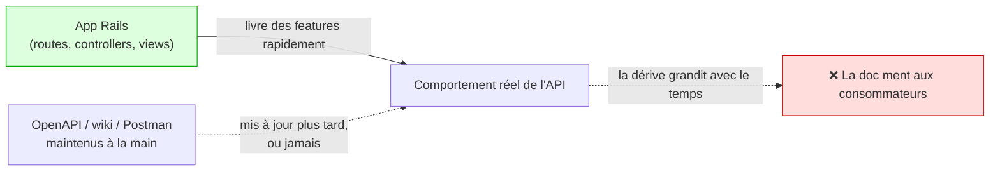
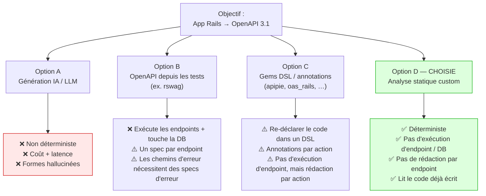
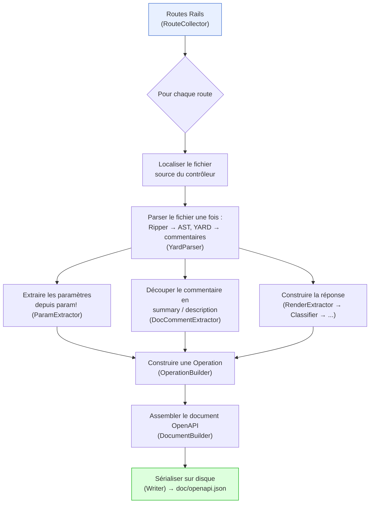
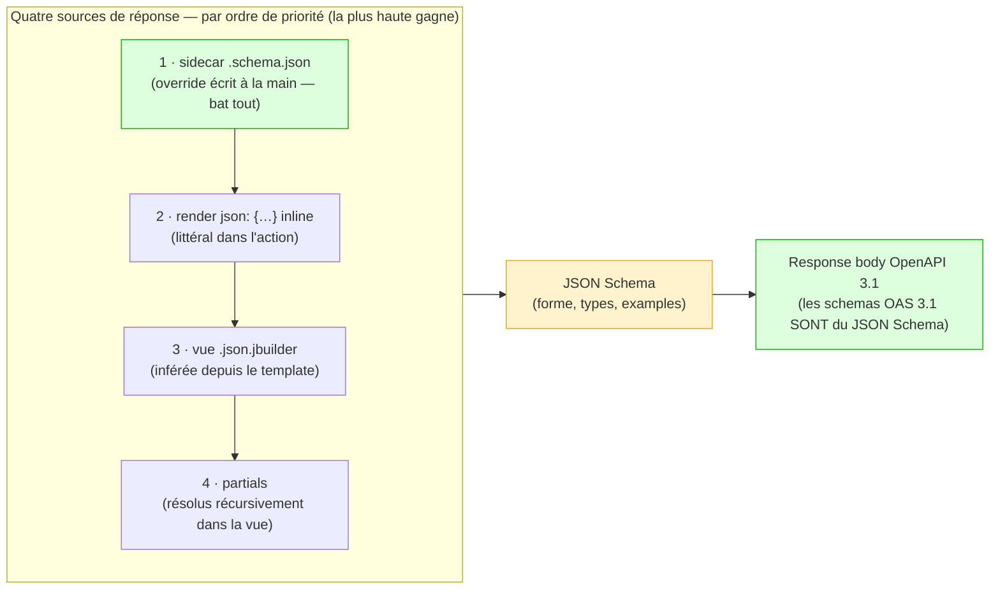
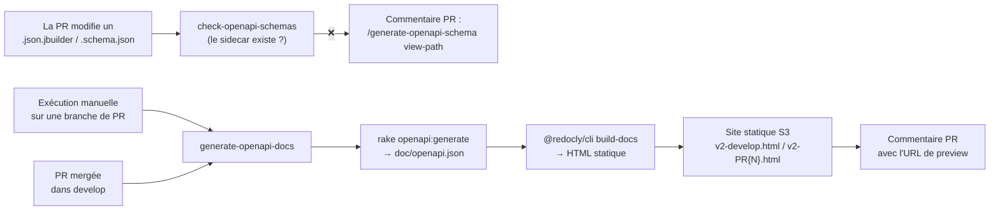

J'ai écrit ceci comme présentation de l'approche derrière [rails-openapi-generator](https://github.com/tonystrawberry/rails-openapi-generator), la gem que j'ai construite pour Spacely afin de générer de la documentation OpenAPI à partir du code Rails par analyse statique.

> Générer un document OpenAPI 3.1 pour une app Rails par **analyse statique du code source**. Aucun code de contrôleur n'est exécuté.

- **Agenda (30 min) :** Contexte (4) · Options envisagées (8) · Comment ça marche (5) · Deep dive (9) · CI & déploiement (3) · Résumé (1)
- 📖 Docs sur GitBook : **[English](https://tonystrawberry.gitbook.io/rails-openapi-generator)** · **[日本語](https://tonystrawberry.gitbook.io/rails-openapi-generator-ja)**

---

## 1. Contexte — le problème
**La documentation API diverge du code.**

- L'app Rails est la vraie source de vérité : routes, params, formes de réponse
- La doc vit ailleurs : YAML écrit à la main, Postman, wiki
- Chaque seconde copie de la vérité finit par être obsolète



### Points de douleur

- **La doc manuelle devient obsolète :** chaque nouveau champ est une édition en plus, et les reviewers attrapent rarement un champ manquant
- **Les consommateurs perdent confiance :** une fois le spec faux, les équipes frontend/mobile lisent le code source à la place
- **Les vieux endpoints n'ont aucune doc :** re-documenter des centaines d'entre eux à la main n'obtient jamais de budget
- **La vérité existe déjà dans le code :** `param!`, `.json.jbuilder`, `render json:`, `rescue_from`. Elle n'est juste pas sous forme OpenAPI.

### L'insight

> **Le code source Rails *est* le spec.** Le traduire à chaque exécution au lieu de maintenir une copie parallèle synchronisée.

- **Le backlog legacy résolu gratuitement :** une seule exécution documente chaque route, sans effort par endpoint
- **Cercle vertueux :** pour améliorer la doc, on améliore le code (`param!`, commentaires YARD, vues honnêtes)

---

## 2. Options envisagées


### Option A — Génération IA / LLM (déjà essayée)

- **Non déterministe :** le même contrôleur donne des schémas différents d'une exécution à l'autre, donc les specs ne peuvent pas être diffés dans les PRs
- **Coût & latence :** faire tourner un modèle sur toute la codebase à chaque génération est lent et cher
- **Hallucination :** invente des champs qui n'existent pas, ou en oublie de vrais
- Un spec est un **contrat** : il doit être exact et reproductible

### Option B — OpenAPI depuis les tests ([rswag](https://github.com/rswag/rswag))

- ✅ Les requêtes s'exécutent vraiment, donc la forme documentée est la forme réelle
- ❌ La CI doit booter l'app, toucher une DB, authentifier des users, et exécuter chaque endpoint
- ❌ On écrit des specs *pour obtenir de la doc* : une surface supplémentaire à maintenir
- ❌ Les chemins d'erreur (`404`, `422`) n'apparaissent que si on écrit des specs d'erreur
- ❌ **Dealbreaker :** il faudrait écrire des specs pour **chaque contrôleur existant**, ce qui n'est pas réaliste

```ruby
# spec/requests/users_spec.rb
RSpec.describe "Users API", type: :request do
  path "/users/{id}" do
    get "Retrieves a user" do
      produces "application/json"
      parameter name: :id, in: :path, type: :integer, required: true

      response "200", "user found" do
        schema type: :object,
               properties: { id: { type: :integer }, name: { type: :string }, email: { type: :string } }
        run_test!   # actually boots the app and hits the endpoint
      end
    end
  end
end
```

### Option C — Gems DSL / annotations

- **[apipie-rails](https://github.com/Apipie/apipie-rails) :** un DSL au-dessus de chaque action (`api`, `param`, `returns`)
- **[oas_rails](https://github.com/a-chacon/oas_rails) :** des tags de commentaire (`# @summary`, `# @parameter`), servis par un engine monté
- **[swagger-blocks](https://github.com/swagger-api/swagger-blocks) / [swagger_yard](https://github.com/livingsocial/swagger_yard-rails) :** schéma écrit à la main sous forme de blocs DSL Ruby ou de tags YARD
- ✅ Aucune n'exécute les endpoints ni n'a besoin d'une DB
- ❌ Toutes font **re-déclarer ce que le contrôleur dit déjà**, action par action
- ❌ Donc elles n'aident pas pour le backlog legacy : on touche encore chaque action

Le même endpoint « show a user » dans chacune :

```ruby
# apipie-rails
api :GET, "/users/:id", "Show a user"
param :id, :number, required: true, desc: "User ID"
returns code: 200, desc: "The user" do
  property :id,    Integer
  property :name,  String
  property :email, String
end
def show
  render json: @user
end
```

```ruby
# oas_rails
# @summary Show a user
# @parameter id(path) [Integer] The user ID
# @response User found(200) [Hash{id: Integer, name: String, email: String}]
def show
  render json: @user
end
```

```ruby
# swagger-blocks
swagger_path "/users/{id}" do
  operation :get do
    key :summary, "Show a user"
    parameter do
      key :name, :id
      key :in, :path
      key :required, true
      key :type, :integer
    end
    response 200 do
      key :description, "user found"
      schema do
        property(:id)    { key :type, :integer }
        property(:name)  { key :type, :string }
        property(:email) { key :type, :string }
      end
    end
  end
end
```

**Cette gem n'a besoin d'aucune de ces choses.** Juste le contrôleur ordinaire :

```ruby
# Show a user
def show
  render json: @user   # or a users/show.json.jbuilder view
end
```

### Option D — Analyse statique custom (cette gem) ✅

**Lire le code, ne jamais l'exécuter.**

| Critère | IA | Tests (rswag) | Gems DSL/annotations | **Statique (cette gem)** |
|---|---|---|---|---|
| Déterministe / sortie byte-identique | ❌ | ⚠️ | ✅ | ✅ |
| Évite d'exécuter les endpoints / d'avoir besoin d'une DB | ✅ | ❌ | ✅ | ✅ |
| Pas de rédaction par endpoint requise | ✅ | ❌ | ❌ | ✅ |
| Utilise le code déjà écrit | ✅ | ❌ | ❌ | ✅ |
| Documente les chemins d'erreur automatiquement | ❌ | ❌ | ❌ | ✅ |
| Coût / latence en CI | Élevé | Élevé | Faible | Faible |
| Exactitude (pas de champs inventés) | ❌ | ✅ | ✅ | ✅ |
| Pas d'outil custom à maintenir en interne | ✅ | ✅ | ✅ | ⚠️ (on en est propriétaire) |

- **À propos du boot de Rails :** toutes ces approches chargent l'environnement Rails
  - Seul rswag exécute les endpoints et a besoin d'une DB
  - Cette gem charge Rails uniquement pour lire la **table des routes** ; le reste est de l'analyse statique du source

**Coûts que l'on accepte**

- **Seul le code littéral est visible :** `render json: User.first.serializable_hash` devient "any" (`{}`) ; les sidecars couvrent les trous
- **Maintenance :** c'est un outil custom, donc on en est propriétaire (la logique de réponse à elle seule fait ~1 000 lignes)
  - Un vrai nouveau pattern de contrôleur peut nécessiter un changement de gem
  - **Tant qu'on continue d'écrire les contrôleurs comme aujourd'hui, aucun changement de gem n'est nécessaire**
  - Les patterns non supportés se dégradent en un schéma permissif ; ils ne cassent pas le build

**Comment ça a été construit : piloté par l'IA, supervisé par un humain**

- La gem a été **écrite presque entièrement par l'IA** ; mon rôle était le **QA** (définir les features, review, valider)
- Un bon candidat pour une approche « freedom » parce que :
  - **Bibliothèque indépendante :** aucun risque de régression pour l'app principale
  - **Facile à tester :** source Rails en entrée → document OpenAPI en sortie
- **Les tests sont le filet de sécurité :** des tests basés sur des fixtures (une app Rails dummy + sortie attendue) attrapent les régressions à chaque amélioration

---

## 3. Comment la gem fonctionne — vue d'ensemble
**Une route en entrée → une opération OpenAPI en sortie**, orchestrée par un seul `Generator`.



### Deux parsers

- **[Ripper](https://docs.ruby-lang.org/en/master/Ripper.html) :** intégré à Ruby ; transforme le source en arbre (AST) ; aucune dépendance supplémentaire
- **[YARD](https://yardoc.org/) :** utilisé uniquement pour lire le commentaire au-dessus de chaque méthode

### D'où viennent les données

| Élément OpenAPI | Source Rails |
|---|---|
| Paths & méthodes HTTP | La table des routes Rails |
| `summary` / `description` | Commentaires YARD au-dessus de l'action |
| Paramètres & request body | Appels `param!` (y compris blocs `Hash` imbriqués) |
| Response body | Par ordre de priorité : sidecar `.schema.json` › `render json:` inline › vue `.json.jbuilder` › partials |
| Status codes | `head`, `render status:`, `redirect_to`, ou convention de méthode HTTP |
| Réponses d'erreur | Handlers `rescue_from` sur la chaîne de contrôleurs |

### Règles de conception

- **Warn, never raise :** un contrôleur cassé laisse quand même un document complet pour les 99 autres
- **Déterministe :** même source → sortie byte-identique, donc le spec peut être commité et diffé
- **Simple :** ~30 petits fichiers à responsabilité unique, câblés explicitement dans un seul `Generator`

---

## 4. Deep dive
### 4.1 De bout en bout : une action → une opération OpenAPI

- Une action et une vue réelles, suivies de la sortie de chaque étape
- Les dumps viennent de l'exécution des classes de la gem sur exactement cet input

**Input**

```ruby
# app/controllers/api/articles_controller.rb
class Api::ArticlesController < ApplicationController
  # Search articles
  # Returns published articles matching the given filters, newest first.
  def index
    param! :q,        String,  blank: false, description: "Free-text search"
    param! :per_page, Integer, in: 1..100, required: false, description: "Page size"
  end
end
```

```ruby
# app/views/api/articles/index.json.jbuilder
json.array! @articles do |article|
  json.id article.id
  json.title article.title
  json.status "published"
  json.author do
    json.name article.author_name
  end
end
```

**Étape 1 — YARD → `DocComment`**

- YARD ne renvoie que le texte brut du commentaire
- Le `DocCommentExtractor` de la gem le découpe : première ligne = summary, le reste = description
- `DocComment` est le struct propre à la gem, pas un type YARD

```ruby
# ── Input: YARD docstring (object.docstring.to_s) ──
"Search articles\nReturns published articles matching the given filters, newest first."

# ── Output: DocCommentExtractor ──
#<DocComment
  summary="Search articles",
  description="Returns published articles matching the given filters, newest first.">
```

**Étape 2 — `ParamExtractor` : AST Ripper → `ParamCall`**

- Lit le nom (symbole), le type (constante) et le hash d'options de chaque nœud `param!`
- `LiteralEvaluator` transforme les littéraux en valeurs Ruby (`1..100` → `Range`)
- Les non-littéraux deviennent `UNRESOLVED` : l'option est abandonnée, `fully_resolved` passe à `false`, et l'exécution rapporte un warning
- Les constantes sont résolues (`Order::STATUSES` → enum) ; les expressions comme `.sort` ne le sont pas

```ruby
# ── Input: param! :q, String, blank: false, description: "Free-text search" ──
[:command,
 [:@ident, "param!", [1, 0]],
 [:args_add_block,
  [[:symbol_literal, [:symbol, [:@ident, "q", [1, 8]]]],       # name → "q"
   [:var_ref, [:@const, "String", [1, 11]]],                   # type → "String"
   [:bare_assoc_hash,                                          # options → LiteralEvaluator
    [[:assoc_new, [:@label, "blank:", [1, 19]], [:var_ref, [:@kw, "false", [1, 26]]]],
     [:assoc_new, [:@label, "description:", [1, 33]],
      [:string_literal, [:string_content, [:@tstring_content, "Free-text search", [1, 47]]]]]]]],
  false]]
# ── Output ──
#<ParamCall name="q", type="String", required=false,
  constraints={:blank=>false, :description=>"Free-text search"}, fully_resolved=true, nested=nil>


# ── Input: param! :per_page, Integer, in: 1..100, required: false, description: "Page size" ──
[:command,
 [:@ident, "param!", [1, 0]],
 [:args_add_block,
  [[:symbol_literal, [:symbol, [:@ident, "per_page", [1, 8]]]],   # name → "per_page"
   [:var_ref, [:@const, "Integer", [1, 18]]],                     # type → "Integer"
   [:bare_assoc_hash,                                            # options → LiteralEvaluator
    [[:assoc_new, [:@label, "in:", [1, 27]],
      [:dot2, [:@int, "1", [1, 31]], [:@int, "100", [1, 34]]]],   # :dot2 range → 1..100
     [:assoc_new, [:@label, "required:", [1, 39]], [:var_ref, [:@kw, "false", [1, 49]]]],
     [:assoc_new, [:@label, "description:", [1, 56]],
      [:string_literal, [:string_content, [:@tstring_content, "Page size", [1, 70]]]]]]]],
  false]]
# ── Output ──
#<ParamCall name="per_page", type="Integer", required=false,
  constraints={:in=>1..100, :description=>"Page size"}, fully_resolved=true, nested=nil>
```

- Les paires du style `[1, 15]` sont des positions dans le source : `[line, column]`

**Étape 3 — `SchemaMapper` : `ParamCall` → schema**

- `blank: false` → `minLength: 1`
- `in: 1..100` → `minimum` / `maximum`

```ruby
q        → {"type"=>"string",  "minLength"=>1, "description"=>"Free-text search"}
per_page → {"type"=>"integer", "minimum"=>1, "maximum"=>100, "description"=>"Page size"}
```

**Étape 4 — `JbuilderParser` : AST de la vue → schema de réponse**

- Parse le template avec Ripper ; ne l'exécute jamais
- `json.array!` + block → array
- `json.<key> <literal>` → propriété typée avec un `example`
- `json.<key> <runtime value>` → `{}` (any)
- `json.<key> do … end` → objet imbriqué
- Les branches `if` / `else` / `case` sont fusionnées : les propriétés de chaque branche apparaissent

```ruby
# ── Input: the view's Ripper AST (trimmed; `...` = omitted slots) ──
[:method_add_block,
 [:command_call,                                             # json.array! @articles
  [:vcall, [:@ident, "json", [1, 0]]], [:@period, ".", [1, 4]],
  [:@ident, "array!", [1, 5]],                               # array! → { type: array }
  [:args_add_block, [[:var_ref, [:@ivar, "@articles", [1, 12]]]], false]],
 [:do_block,
  [:block_var, [:params, [[:@ident, "article", [1, 26]]], ...], false],
  [:bodystmt,
   [[:command_call,                                          # json.id article.id
     [:vcall, [:@ident, "json", [2, 2]]], [:@period, ".", [2, 6]],
     [:@ident, "id", [2, 7]],                                # key "id"
     [:args_add_block,
      [[:call, [:var_ref, [:@ident, "article", ...]], [:@period, "."], [:@ident, "id", ...]]],  # runtime → {}
      false]],
    [:command_call,                                          # json.title article.title
     [:vcall, [:@ident, "json", [3, 2]]], [:@period, "."], [:@ident, "title", [3, 7]],
     [:args_add_block, [[:call, ...article.title... ]], false]],   # runtime → {}
    [:command_call,                                          # json.status "published"
     [:vcall, [:@ident, "json", [4, 2]]], [:@period, "."], [:@ident, "status", [4, 7]],
     [:args_add_block,
      [[:string_literal, [:string_content, [:@tstring_content, "published", [4, 15]]]]],  # literal → typed + example
      false]],
    [:method_add_block,                                      # json.author do ... end
     [:call, [:vcall, [:@ident, "json", [5, 2]]], [:@period, "."], [:@ident, "author", [5, 7]]],
     [:do_block, nil,
      [:bodystmt,
       [[:command_call,                                      # json.name article.author_name
         [:vcall, [:@ident, "json", [6, 4]]], [:@period, "."], [:@ident, "name", [6, 9]],
         [:args_add_block, [[:call, ...article.author_name... ]], false]]],  # runtime → {}
       ...]]]],
   ...]]]
# ── Output ──
{
  "type": "array",
  "items": {
    "type": "object",
    "properties": {
      "author": { "type": "object", "properties": { "name": {} } },
      "id": {},
      "status": { "type": "string", "example": "published" },
      "title": {}
    }
  }
}
```

**Étape 5 — `OperationBuilder` : une route → `Endpoint`**

- S'exécute une fois par route ; produit le struct interne de la gem (pas encore du JSON OpenAPI)
- Décide où va chaque param : path, query ou body (pour un `GET`, query)
- Déplace chaque `description` du schema vers le paramètre
- Ajoute une référence source, l'`operationId` et le tag du contrôleur

```ruby
# ── Input ──
route           = Route(GET "/api/articles" → api/articles#index)
doc_comment     = DocComment(...)                          # Stage 1
param_calls     = [ParamCall(q …), ParamCall(per_page …)]  # Stage 2
response        = Response(200, body: <jbuilder schema>)   # Stage 4
source_location = "app/controllers/api/articles_controller.rb:4"

# ── Output ──
#<struct Endpoint
 http_method="GET",
 path="/api/articles",
 summary="Search articles",
 description="Returns published articles matching the given filters, newest first.\n\n" +
             "_Source: `app/controllers/api/articles_controller.rb:4`_",
 parameters=
  [#<struct Parameter name="q", location=:query, required=false,
     schema={"type"=>"string", "minLength"=>1},             # description moved out of schema…
     description="Free-text search">,                       # …onto the parameter
   #<struct Parameter name="per_page", location=:query, required=false,
     schema={"type"=>"integer", "minimum"=>1, "maximum"=>100},
     description="Page size">],
 request_body=nil,                                          # GET → no body
 operation_id="get_api_articles",
 tag="Api::ArticlesController",
 response=
  #<struct Response kind=:json, description="Successful response",
    entries=[#<struct ResponseEntry status=200, body={"type"=>"array", "items"=>{…}}, content_types=nil>]>>
```

**Étape 6 — `DocumentBuilder` : tous les `Endpoint`s → document OpenAPI**

- S'exécute une fois pour toute l'app
- Ajoute le `openapi`, `info` et `tags` de premier niveau
- Groupe les endpoints par path, puis par méthode ; trie tout (paramètres par nom) pour une sortie déterministe
- Convertit `:id` → `{id}` et construit les `responses` avec les content types

```ruby
# ── Input ──
endpoints = [Endpoint(GET /api/articles), …]   # one per route, from Stage 5
configuration.title = "My API"                 # api_version defaults to "1.0.0"
```

```json
{
  "openapi": "3.1.0",
  "info": { "title": "My API", "version": "1.0.0" },
  "tags": [{ "name": "Api::ArticlesController" }],
  "paths": {
    "/api/articles": {
      "get": {
        "operationId": "get_api_articles",
        "tags": ["Api::ArticlesController"],
        "summary": "Search articles",
        "description": "Returns published articles matching the given filters, newest first.\n\n_Source: `app/controllers/api/articles_controller.rb:4`_",
        "parameters": [
          {
            "name": "per_page",
            "in": "query",
            "required": false,
            "description": "Page size",
            "schema": { "type": "integer", "minimum": 1, "maximum": 100 }
          },
          {
            "name": "q",
            "in": "query",
            "required": false,
            "description": "Free-text search",
            "schema": { "type": "string", "minLength": 1 }
          }
        ],
        "responses": {
          "200": {
            "description": "Successful response",
            "content": {
              "application/json": {
                "schema": {
                  "type": "array",
                  "items": {
                    "type": "object",
                    "properties": {
                      "author": { "type": "object", "properties": { "name": {} } },
                      "id": {},
                      "status": { "type": "string", "example": "published" },
                      "title": {}
                    }
                  }
                }
              }
            }
          }
        }
      }
    }
  }
}
```

- Chaque champ remonte à du code littéral dans le contrôleur ou la vue
- Un sidecar écraserait le body `200` si l'inférence ne suffisait pas (§4.4)

### 4.2 Pourquoi JSON Schema pour les response bodies



**Priorité (la plus haute gagne)**

1. **Sidecar :** écrase tout
2. **`render json:` inline :** bat la vue (plus spécifique)
3. **Vue `.json.jbuilder` :** utilisée sinon
4. **Partials :** résolus à l'intérieur de la vue, pas une source séparée

**Pourquoi JSON Schema**

- **Les schemas OpenAPI 3.1 *sont* du JSON Schema :** aucune couche de traduction nécessaire
- **Il décrit la forme sans les données :** exactement ce qu'on obtient sans exécuter le code
- **C'est le format d'override naturel :** sidecars écrits à la main et schemas inférés sont interchangeables

**À quoi ressemble JSON Schema**

- Une réponse JSON est de la *donnée* : un exemple concret

```json
{ "id": 42, "email": "alice@example.com", "role": "admin" }
```

- Un JSON Schema décrit la *forme* de toute réponse valide

```json
{
  "type": "object",
  "required": ["id", "email"],
  "properties": {
    "id":    { "type": "integer", "minimum": 1, "example": 42 },
    "email": { "type": "string", "format": "email", "example": "alice@example.com" },
    "role":  { "type": "string", "enum": ["admin", "member"] }
  }
}
```

- `type` : quelle sorte de valeur (object, string, integer, array…)
- `required` : quels champs doivent toujours être présents
- `format`, `enum`, `minimum` : règles supplémentaires sur la valeur
- `example` : une valeur d'exemple affichée dans la doc
- C'est aussi exactement ce qu'on écrirait dans un sidecar `.schema.json` (§4.4)

**Le même genre de schema, inféré depuis une vue jbuilder**

```ruby
# app/views/api/users/_user.json.jbuilder
json.extract! user, :id, :name, :email
json.role "member"
json.profile do
  json.bio user.bio
end
```

```json
{
  "type": "object",
  "properties": {
    "id":    {},
    "name":  {},
    "email": {},
    "role":    { "type": "string", "example": "member" },
    "profile": {
      "type": "object",
      "properties": { "bio": {} }
    }
  }
}
```

- Littéral (`"member"`) → type + example
- Donnée runtime (`user.bio`, `extract!`) → `{}` : honnête sur ce qu'on ne peut pas savoir

### 4.3 Suivre le code : réponses d'erreur automatiques

- Les renders se cachent souvent dans des helpers, `before_action` ou `rescue_from`
- La gem les suit à travers la chaîne de contrôleurs (concerns inclus), jusqu'à une profondeur configurable
- Les arguments littéraux au site d'appel sont transmis au helper

```ruby
rescue_from Pundit::NotAuthorizedError, with: :render_forbidden

def render_forbidden
  render_error(status: :forbidden, code: "FORBIDDEN", message: "...")
end

def render_error(status:, code:, message:)
  render json: { error: { code: code, message: message } }, status: status
end
```

- → chaque opération obtient une réponse **`403`** avec le bon body, trouvée à deux appels de profondeur
- Aucun spec de chemin d'erreur nécessaire (contrairement à rswag)

### 4.4 L'échappatoire : les sidecars JSON Schema

- Quand l'inférence ne suffit pas, on dépose un `.schema.json`
- Il est utilisé tel quel, en remplacement de l'inférence

```text
app/views/api/users/_user.schema.json   # wherever the partial is used
app/views/api/users/show.schema.json    # the action's response
app/views/api/users/create.schema.json  # works even with no view (inline render)
```

- JSON malformé → un warning, puis fallback sur l'inférence (never raises)

---

## 5. CI et déploiement

### Avant : le repo `api_specification` (maintenant archivé)

- Un spec écrit à la main dans un **repo séparé**, avec sa propre CI et upload S3
- Chaque changement d'API nécessitait une seconde PR dans un second repo, le problème de dérive du §1
- Archivé : la génération et le déploiement vivent désormais dans **spacely_web** lui-même

### Maintenant : deux workflows dans spacely_web



- **Setup :** la gem vient de git, dans le groupe `:development`. L'initializer est protégé par `defined?(RailsOpenapiGenerator)` et ne configure que `title` et `exclude_source_paths: ["vendor/"]`

### Workflow 1 : `generate-openapi-docs.yml` : générer et publier

- **Au merge dans develop** → `v2-develop.html`, une URL partagée qui montre toujours le dernier develop
- **Exécution manuelle sur une branche de PR** (`workflow_dispatch`) → une preview par PR, `v2-PR{N}.html`
- **Étapes :** `bundle exec rake openapi:generate OUTPUT=doc/openapi.json FORMAT=json` → HTML Redoc → `aws s3 cp` (rôle OIDC, pas de clés stockées)
- **Commentaire PR :** un commentaire avec l'URL et le SHA du commit, mis à jour sur place (trouvé via un marqueur caché)
- **Pas de service database dans le job :** seulement Ruby et Node, parce que la gem n'exécute jamais les actions
- **Le préfixe `v2-`** évite d'écraser le `index.html` / `PR{N}.html` de l'ancien repo dans le même bucket
- Accès via le VPN

### Workflow 2 : `check-openapi-schemas.yml` : la gate des sidecars

- Tourne sur les PRs qui touchent `app/views/**/*.json.jbuilder` ou `*.schema.json`
- Diff contre la base de la PR (`git diff --name-status -M base...HEAD`) :

| Changement sur un `.json.jbuilder` | Règle |
|---|---|
| Added / modified | un `.schema.json` sibling doit exister |
| Deleted | son `.schema.json` doit être supprimé aussi |
| Renamed | le sidecar doit bouger avec |

- **En cas d'échec :** annotations sur les fichiers + **un commentaire PR** avec la commande exacte de fix. Le commentaire est supprimé une fois la PR corrigée
- **Vérifie l'existence, pas la correction :** les reviewers vérifient toujours que le sidecar correspond à la vue

### Corriger un échec : le skill Claude Code `/generate-openapi-schema`

- Input : un chemin jbuilder ou un endpoint (`GET /api/v4/...`, `Controller#action`)
- Lit la vue, ses partials, les models et `db/schema.rb` → écrit un brouillon de sidecar 2020-12
- Les règles vivent dans `app/views/AGENTS.md` (nullabilité en `["string", "null"]`, enums depuis le model, `$defs` pour les partials)
- **Couverture aujourd'hui :** 250 sidecars pour 444 vues jbuilder. La gate fait croître ce nombre à chaque PR qui touche une vue

---

## Résumé
- **Problème :** la doc dérive du code, et les endpoints legacy n'ont jamais été documentés
- **Insight :** le code source Rails est le spec ; une seule exécution documente chaque route
- **Rejeté :** IA (non déterministe), rswag (exécute les endpoints, un spec par endpoint), gems DSL (re-déclarer tout)
- **Choisi :** analyse statique avec Ripper + YARD : déterministe, pas de DB, pas de rédaction par endpoint
- **Choix clé :** JSON Schema pour les réponses, parce que les schemas OpenAPI 3.1 *sont* du JSON Schema
- **Filet de sécurité :** warn-never-raise + overrides sidecar
- **Trade-off :** on le maintient, mais les conventions de contrôleur actuelles ne nécessitent aucun changement de gem
- **Livraison :** la CI de spacely_web publie la doc à chaque merge dans develop. La gate des sidecars fait croître les schemas de réponse à chaque PR

---

## Pour aller plus loin

GitBook : **[English](https://tonystrawberry.gitbook.io/rails-openapi-generator)** · **[日本語](https://tonystrawberry.gitbook.io/rails-openapi-generator-ja)**

- **Features :** [YARD comments](https://tonystrawberry.gitbook.io/rails-openapi-generator/features/yard-comments) · [Parameters](https://tonystrawberry.gitbook.io/rails-openapi-generator/features/parameters) · [Response Bodies](https://tonystrawberry.gitbook.io/rails-openapi-generator/features/response-bodies) · [Status Codes](https://tonystrawberry.gitbook.io/rails-openapi-generator/features/status-codes) · [Error Responses](https://tonystrawberry.gitbook.io/rails-openapi-generator/features/error-responses) · [HTML & File Responses](https://tonystrawberry.gitbook.io/rails-openapi-generator/features/html-and-file-responses)
- **Guides :** [JSON Schema Sidecars](https://tonystrawberry.gitbook.io/rails-openapi-generator/guides/schema-sidecars) · [Route Filtering](https://tonystrawberry.gitbook.io/rails-openapi-generator/guides/route-filtering) · [Previewing the Spec](https://tonystrawberry.gitbook.io/rails-openapi-generator/guides/previewing-docs) · [Programmatic Use](https://tonystrawberry.gitbook.io/rails-openapi-generator/guides/programmatic-use)
- **Getting started :** [Installation](https://tonystrawberry.gitbook.io/rails-openapi-generator/getting-started/installation) · [Quick Start](https://tonystrawberry.gitbook.io/rails-openapi-generator/getting-started/quick-start) · [Configuration](https://tonystrawberry.gitbook.io/rails-openapi-generator/getting-started/configuration)
- **Reference & examples :** [Configuration Options](https://tonystrawberry.gitbook.io/rails-openapi-generator/reference/configuration) · [Basic CRUD API](https://tonystrawberry.gitbook.io/rails-openapi-generator/examples/basic-crud-api) · [Nested Parameters](https://tonystrawberry.gitbook.io/rails-openapi-generator/examples/nested-params)

---

> 🌐 *Traduit par Claude*
