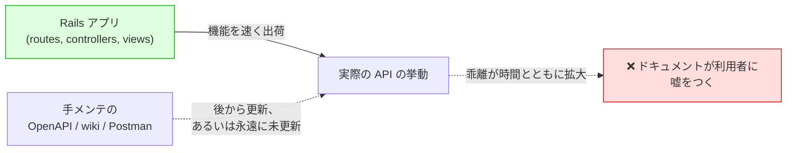
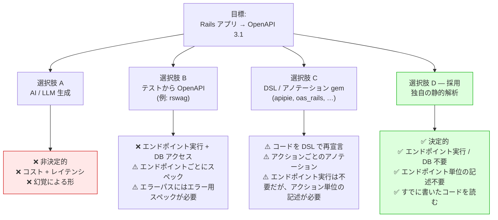
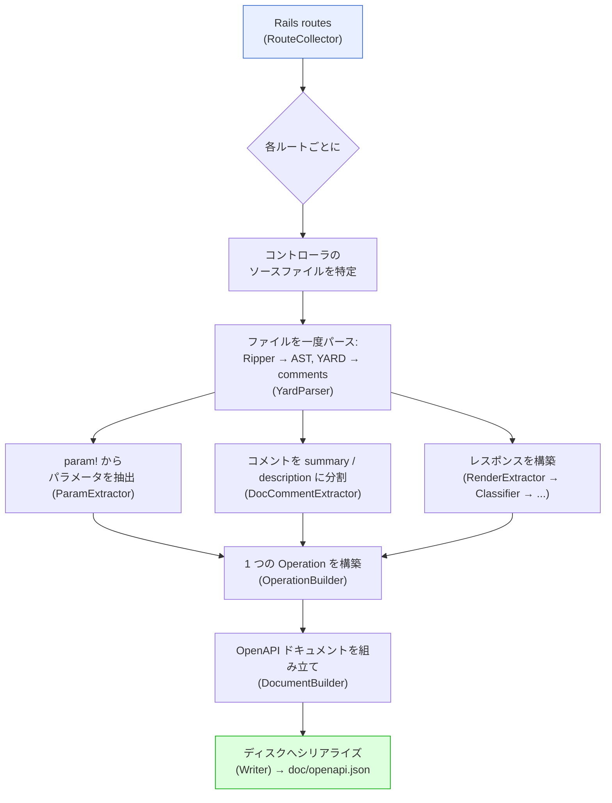
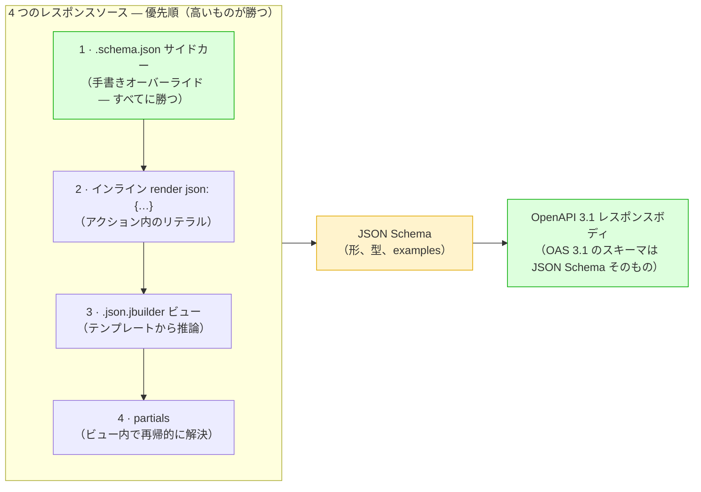
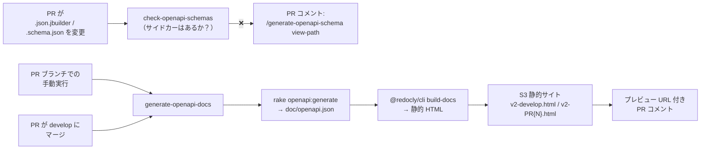

[rails-openapi-generator](https://github.com/tonystrawberry/rails-openapi-generator) のアプローチをプレゼンとしてまとめたものです。Spacely 向けに作った gem で、Rails ソースの静的解析から OpenAPI ドキュメントを生成します。

> Rails アプリ向けの OpenAPI 3.1 ドキュメントを **静的ソース解析** で生成する。コントローラのコードは一切実行しない。

- **アジェンダ（30 分）：** 背景（4）· 検討した選択肢（8）· 仕組み（5）· 深掘り（9）· CI & デプロイ（3）· まとめ（1）
- 📖 GitBook のドキュメント：**[English](https://tonystrawberry.gitbook.io/rails-openapi-generator)** · **[日本語](https://tonystrawberry.gitbook.io/rails-openapi-generator-ja)**

---

## 1. 背景 — 問題
**API ドキュメントはコードから乖離する。**

- 本当のソース・オブ・トゥルースは Rails アプリ：routes、params、レスポンスの形
- ドキュメントは別の場所にある：手書き YAML、Postman、wiki
- 真実のコピーが二つあるたびに、古くなる



### 痛みどころ

- **手書きドキュメントはすぐ古くなる：** フィールドを足すたびに別途編集が要り、レビュアーが欠けに気づくことは稀
- **利用者が信頼を失う：** スペックが一度間違うと、フロントエンド／モバイルチームはソースを読むようになる
- **古いエンドポイントにはドキュメントがない：** 数百件を手で後から書く予算は、まず付かない
- **真実はすでにコードにある：** `param!`、`.json.jbuilder`、`render json:`、`rescue_from`。ただ OpenAPI の形になっていないだけ

### 気づき

> **Rails のソース *こそが* スペックだ。** 並行コピーを同期し続けるのではなく、実行のたびに変換する。

- **レガシーのバックログが無料で解消：** 1 回の実行ですべてのルートがドキュメント化され、エンドポイント単位の手間は不要
- **好循環：** ドキュメントを良くするには、コードを良くする（`param!`、YARD コメント、正直なビュー）

---

## 2. 検討した選択肢


### 選択肢 A — AI / LLM 生成（以前試した）

- **非決定的：** 同じコントローラでも実行ごとにスキーマが変わり、PR で diff できない
- **コストとレイテンシ：** 生成のたびにモデルをコードベース全体に通すのは遅くて高い
- **幻覚：** 存在しないフィールドを捏造したり、本物を落としたりする
- スペックは **契約** である：正確で再現可能でなければならない

### 選択肢 B — テストから OpenAPI（[rswag](https://github.com/rswag/rswag)）

- ✅ リクエストが本当に走るので、ドキュメント化された形は実際の形になる
- ❌ CI はアプリを起動し、DB に当たり、ユーザーにサインインし、全エンドポイントを実行する必要がある
- ❌ ドキュメントのためにスペックを書く：メンテ対象の表面が増える
- ❌ エラーパス（`404`、`422`）は、エラー用スペックを書かないと出てこない
- ❌ **決め手：** **既存のすべてのコントローラ** にスペックを書く必要があり、現実的ではない

```ruby
# spec/requests/users_spec.rb
RSpec.describe "Users API", type: :request do
  path "/users/{id}" do
    get "Retrieves a user" do
      produces "application/json"
      parameter name: :id, in: :path, type: :integer, required: true

      response "200", "user found" do
        schema type: :object,
               properties: { id: { type: :integer }, name: { type: :string }, email: { type: :string } }
        run_test!   # actually boots the app and hits the endpoint
      end
    end
  end
end
```

### 選択肢 C — DSL / アノテーション gem

- **[apipie-rails](https://github.com/Apipie/apipie-rails):** 各アクションの上に DSL（`api`、`param`、`returns`）
- **[oas_rails](https://github.com/a-chacon/oas_rails):** コメントタグ（`# @summary`、`# @parameter`）。マウントしたエンジンが配信
- **[swagger-blocks](https://github.com/swagger-api/swagger-blocks) / [swagger_yard](https://github.com/livingsocial/swagger_yard-rails):** Ruby DSL ブロックや YARD タグとして手書きスキーマ
- ✅ いずれもエンドポイントを実行せず、DB も不要
- ❌ いずれも **コントローラがすでに言っていることを、アクションごとに再宣言** させる
- ❌ だからレガシーのバックログには効かない：結局すべてのアクションに触る

同じ「ユーザーを表示」エンドポイントを、それぞれで：

```ruby
# apipie-rails
api :GET, "/users/:id", "Show a user"
param :id, :number, required: true, desc: "User ID"
returns code: 200, desc: "The user" do
  property :id,    Integer
  property :name,  String
  property :email, String
end
def show
  render json: @user
end
```

```ruby
# oas_rails
# @summary Show a user
# @parameter id(path) [Integer] The user ID
# @response User found(200) [Hash{id: Integer, name: String, email: String}]
def show
  render json: @user
end
```

```ruby
# swagger-blocks
swagger_path "/users/{id}" do
  operation :get do
    key :summary, "Show a user"
    parameter do
      key :name, :id
      key :in, :path
      key :required, true
      key :type, :integer
    end
    response 200 do
      key :description, "user found"
      schema do
        property(:id)    { key :type, :integer }
        property(:name)  { key :type, :string }
        property(:email) { key :type, :string }
      end
    end
  end
end
```

**この gem には、そのどれも不要。** 普通のコントローラだけでよい：

```ruby
# Show a user
def show
  render json: @user   # or a users/show.json.jbuilder view
end
```

### 選択肢 D — 独自の静的解析（この gem）✅

**コードを読み、決して実行しない。**

| 観点 | AI | テスト (rswag) | DSL/アノテーション gem | **静的解析（この gem）** |
|---|---|---|---|---|
| 決定的 / バイト単位で同一の出力 | ❌ | ⚠️ | ✅ | ✅ |
| エンドポイント実行 / DB 不要 | ✅ | ❌ | ✅ | ✅ |
| エンドポイント単位の記述不要 | ✅ | ❌ | ❌ | ✅ |
| すでに書いたコードを使う | ✅ | ❌ | ❌ | ✅ |
| エラーパスを自動でドキュメント化 | ❌ | ❌ | ❌ | ✅ |
| CI でのコスト / レイテンシ | High | High | Low | Low |
| 正確さ（捏造フィールドなし） | ❌ | ✅ | ✅ | ✅ |
| 社内で独自ツールをメンテしなくてよい | ✅ | ✅ | ✅ | ⚠️（自前で持つ） |

- **Rails の起動について：** いずれも Rails 環境をロードする
  - エンドポイントを実行し DB が要るのは rswag だけ
  - この gem が Rails をロードするのは **ルートテーブル** を読むためだけ；残りは静的ソース解析

**受け入れるコスト**

- **リテラルなコードだけが見える：** `render json: User.first.serializable_hash` は「any」（`{}`）になる；ギャップはサイドカーで埋める
- **メンテナンス：** カスタムツールなので自前で持つ（レスポンスまわりだけでも約 1,000 行）
  - 本当に新しいコントローラパターンが出ると、gem の変更が要ることがある
  - **今の書き方のままコントローラを書き続ける限り、gem の変更は不要**
  - 未対応パターンは寛容なスキーマに落ちる；ビルドは壊さない

**どう作ったか：AI 駆動、人間が監督**

- gem は **ほぼ AI が書いた**；私の役割は **QA**（機能の定義、レビュー、検証）
- 「自由」なアプローチに合う理由：
  - **独立したライブラリ：** 本アプリへの回帰リスクがない
  - **テストしやすい：** Rails ソース in → OpenAPI ドキュメント out
- **テストがセーフティネット：** フィクスチャベースのテスト（ダミー Rails アプリ + 期待出力）が、改善のたびに回帰を捕まえる

---

## 3. gem の仕組み — 概要
**1 ルート in → 1 OpenAPI operation out。** 単一の `Generator` がオーケストレーションする。



### ふたつのパーサ

- **[Ripper](https://docs.ruby-lang.org/en/master/Ripper.html):** Ruby 組み込み；ソースを木（AST）に変換；追加依存なし
- **[YARD](https://yardoc.org/):** 各メソッド上のコメントを読むためだけに使う

### データの出所

| OpenAPI の部品 | Rails ソース |
|---|---|
| Paths & HTTP methods | Rails のルートテーブル |
| `summary` / `description` | アクション上の YARD コメント |
| Parameters & request body | `param!` 呼び出し（ネストした `Hash` ブロック含む） |
| Response body | 優先順：`.schema.json` サイドカー › インライン `render json:` › `.json.jbuilder` ビュー › partials |
| Status codes | `head`、`render status:`、`redirect_to`、または HTTP メソッドの慣習 |
| Error responses | コントローラチェーン上の `rescue_from` ハンドラ |

### 設計ルール

- **警告し、決して raise しない：** 1 つの壊れたコントローラがあっても、残りの 99 には完全なドキュメントが残る
- **決定的：** 同じソース → バイト単位で同一の出力。スペックをコミットして diff できる
- **シンプル：** 約 30 の小さな単一目的ファイル。1 つの `Generator` で明示的に結びつける

---

## 4. 深掘り
### 4.1 エンドツーエンド：1 アクション → OpenAPI operation

- 実際のアクションとビュー、その後に各ステージの出力
- ダンプは、この入力に対して gem 自身のクラスを走らせたもの

**入力**

```ruby
# app/controllers/api/articles_controller.rb
class Api::ArticlesController < ApplicationController
  # Search articles
  # Returns published articles matching the given filters, newest first.
  def index
    param! :q,        String,  blank: false, description: "Free-text search"
    param! :per_page, Integer, in: 1..100, required: false, description: "Page size"
  end
end
```

```ruby
# app/views/api/articles/index.json.jbuilder
json.array! @articles do |article|
  json.id article.id
  json.title article.title
  json.status "published"
  json.author do
    json.name article.author_name
  end
end
```

**ステージ 1 — YARD → `DocComment`**

- YARD が返すのは生のコメントテキストだけ
- gem の `DocCommentExtractor` が分割する：先頭行 = summary、残り = description
- `DocComment` は gem 独自の struct であり、YARD の型ではない

```ruby
# ── Input: YARD docstring (object.docstring.to_s) ──
"Search articles\nReturns published articles matching the given filters, newest first."

# ── Output: DocCommentExtractor ──
#<DocComment
  summary="Search articles",
  description="Returns published articles matching the given filters, newest first.">
```

**ステージ 2 — `ParamExtractor`: Ripper AST → `ParamCall`**

- 各 `param!` ノードから名前（シンボル）、型（定数）、オプションハッシュを読む
- `LiteralEvaluator` がリテラルを Ruby の値に変換する（`1..100` → `Range`）
- 非リテラルは `UNRESOLVED` になる：オプションは落ち、`fully_resolved` が `false` になり、実行は警告を出す
- 定数は解決する（`Order::STATUSES` → enum）；`.sort` のような式は解決しない

```ruby
# ── Input: param! :q, String, blank: false, description: "Free-text search" ──
[:command,
 [:@ident, "param!", [1, 0]],
 [:args_add_block,
  [[:symbol_literal, [:symbol, [:@ident, "q", [1, 8]]]],       # name → "q"
   [:var_ref, [:@const, "String", [1, 11]]],                   # type → "String"
   [:bare_assoc_hash,                                          # options → LiteralEvaluator
    [[:assoc_new, [:@label, "blank:", [1, 19]], [:var_ref, [:@kw, "false", [1, 26]]]],
     [:assoc_new, [:@label, "description:", [1, 33]],
      [:string_literal, [:string_content, [:@tstring_content, "Free-text search", [1, 47]]]]]]]],
  false]]
# ── Output ──
#<ParamCall name="q", type="String", required=false,
  constraints={:blank=>false, :description=>"Free-text search"}, fully_resolved=true, nested=nil>


# ── Input: param! :per_page, Integer, in: 1..100, required: false, description: "Page size" ──
[:command,
 [:@ident, "param!", [1, 0]],
 [:args_add_block,
  [[:symbol_literal, [:symbol, [:@ident, "per_page", [1, 8]]]],   # name → "per_page"
   [:var_ref, [:@const, "Integer", [1, 18]]],                     # type → "Integer"
   [:bare_assoc_hash,                                            # options → LiteralEvaluator
    [[:assoc_new, [:@label, "in:", [1, 27]],
      [:dot2, [:@int, "1", [1, 31]], [:@int, "100", [1, 34]]]],   # :dot2 range → 1..100
     [:assoc_new, [:@label, "required:", [1, 39]], [:var_ref, [:@kw, "false", [1, 49]]]],
     [:assoc_new, [:@label, "description:", [1, 56]],
      [:string_literal, [:string_content, [:@tstring_content, "Page size", [1, 70]]]]]]]],
  false]]
# ── Output ──
#<ParamCall name="per_page", type="Integer", required=false,
  constraints={:in=>1..100, :description=>"Page size"}, fully_resolved=true, nested=nil>
```

- `[1, 15]` 形式のペアはソース位置：`[line, column]`

**ステージ 3 — `SchemaMapper`: `ParamCall` → schema**

- `blank: false` → `minLength: 1`
- `in: 1..100` → `minimum` / `maximum`

```ruby
q        → {"type"=>"string",  "minLength"=>1, "description"=>"Free-text search"}
per_page → {"type"=>"integer", "minimum"=>1, "maximum"=>100, "description"=>"Page size"}
```

**ステージ 4 — `JbuilderParser`: ビュー AST → レスポンススキーマ**

- テンプレートを Ripper でパースする；決して実行しない
- `json.array!` + ブロック → array
- `json.<key> <literal>` → `example` 付きの型付きプロパティ
- `json.<key> <runtime value>` → `{}`（any）
- `json.<key> do … end` → ネストしたオブジェクト
- `if` / `else` / `case` の分岐はマージ：すべての分岐のプロパティが現れる

```ruby
# ── Input: the view's Ripper AST (trimmed; `...` = omitted slots) ──
[:method_add_block,
 [:command_call,                                             # json.array! @articles
  [:vcall, [:@ident, "json", [1, 0]]], [:@period, ".", [1, 4]],
  [:@ident, "array!", [1, 5]],                               # array! → { type: array }
  [:args_add_block, [[:var_ref, [:@ivar, "@articles", [1, 12]]]], false]],
 [:do_block,
  [:block_var, [:params, [[:@ident, "article", [1, 26]]], ...], false],
  [:bodystmt,
   [[:command_call,                                          # json.id article.id
     [:vcall, [:@ident, "json", [2, 2]]], [:@period, ".", [2, 6]],
     [:@ident, "id", [2, 7]],                                # key "id"
     [:args_add_block,
      [[:call, [:var_ref, [:@ident, "article", ...]], [:@period, "."], [:@ident, "id", ...]]],  # runtime → {}
      false]],
    [:command_call,                                          # json.title article.title
     [:vcall, [:@ident, "json", [3, 2]]], [:@period, "."], [:@ident, "title", [3, 7]],
     [:args_add_block, [[:call, ...article.title... ]], false]],   # runtime → {}
    [:command_call,                                          # json.status "published"
     [:vcall, [:@ident, "json", [4, 2]]], [:@period, "."], [:@ident, "status", [4, 7]],
     [:args_add_block,
      [[:string_literal, [:string_content, [:@tstring_content, "published", [4, 15]]]]],  # literal → typed + example
      false]],
    [:method_add_block,                                      # json.author do ... end
     [:call, [:vcall, [:@ident, "json", [5, 2]]], [:@period, "."], [:@ident, "author", [5, 7]]],
     [:do_block, nil,
      [:bodystmt,
       [[:command_call,                                      # json.name article.author_name
         [:vcall, [:@ident, "json", [6, 4]]], [:@period, "."], [:@ident, "name", [6, 9]],
         [:args_add_block, [[:call, ...article.author_name... ]], false]]],  # runtime → {}
       ...]]]],
   ...]]]
# ── Output ──
{
  "type": "array",
  "items": {
    "type": "object",
    "properties": {
      "author": { "type": "object", "properties": { "name": {} } },
      "id": {},
      "status": { "type": "string", "example": "published" },
      "title": {}
    }
  }
}
```

**ステージ 5 — `OperationBuilder`: 1 ルート → `Endpoint`**

- ルートごとに一度走る；gem の内部 struct を作る（まだ OpenAPI JSON ではない）
- 各パラメータの行き先を決める：path、query、または body（`GET` なら query）
- 各 `description` をスキーマからパラメータへ移す
- ソース参照、`operationId`、コントローラのタグを付ける

```ruby
# ── Input ──
route           = Route(GET "/api/articles" → api/articles#index)
doc_comment     = DocComment(...)                          # Stage 1
param_calls     = [ParamCall(q …), ParamCall(per_page …)]  # Stage 2
response        = Response(200, body: <jbuilder schema>)   # Stage 4
source_location = "app/controllers/api/articles_controller.rb:4"

# ── Output ──
#<struct Endpoint
 http_method="GET",
 path="/api/articles",
 summary="Search articles",
 description="Returns published articles matching the given filters, newest first.\n\n" +
             "_Source: `app/controllers/api/articles_controller.rb:4`_",
 parameters=
  [#<struct Parameter name="q", location=:query, required=false,
     schema={"type"=>"string", "minLength"=>1},             # description moved out of schema…
     description="Free-text search">,                       # …onto the parameter
   #<struct Parameter name="per_page", location=:query, required=false,
     schema={"type"=>"integer", "minimum"=>1, "maximum"=>100},
     description="Page size">],
 request_body=nil,                                          # GET → no body
 operation_id="get_api_articles",
 tag="Api::ArticlesController",
 response=
  #<struct Response kind=:json, description="Successful response",
    entries=[#<struct ResponseEntry status=200, body={"type"=>"array", "items"=>{…}}, content_types=nil>]>>
```

**ステージ 6 — `DocumentBuilder`: すべての `Endpoint` → OpenAPI ドキュメント**

- アプリ全体で一度走る
- トップレベルの `openapi`、`info`、`tags` を付ける
- エンドポイントを path、次に method でグループ化し、すべてソートする（パラメータは名前順）— 決定的な出力のため
- `:id` → `{id}` に変換し、content types 付きの `responses` を組み立てる

```ruby
# ── Input ──
endpoints = [Endpoint(GET /api/articles), …]   # one per route, from Stage 5
configuration.title = "My API"                 # api_version defaults to "1.0.0"
```

```json
{
  "openapi": "3.1.0",
  "info": { "title": "My API", "version": "1.0.0" },
  "tags": [{ "name": "Api::ArticlesController" }],
  "paths": {
    "/api/articles": {
      "get": {
        "operationId": "get_api_articles",
        "tags": ["Api::ArticlesController"],
        "summary": "Search articles",
        "description": "Returns published articles matching the given filters, newest first.\n\n_Source: `app/controllers/api/articles_controller.rb:4`_",
        "parameters": [
          {
            "name": "per_page",
            "in": "query",
            "required": false,
            "description": "Page size",
            "schema": { "type": "integer", "minimum": 1, "maximum": 100 }
          },
          {
            "name": "q",
            "in": "query",
            "required": false,
            "description": "Free-text search",
            "schema": { "type": "string", "minLength": 1 }
          }
        ],
        "responses": {
          "200": {
            "description": "Successful response",
            "content": {
              "application/json": {
                "schema": {
                  "type": "array",
                  "items": {
                    "type": "object",
                    "properties": {
                      "author": { "type": "object", "properties": { "name": {} } },
                      "id": {},
                      "status": { "type": "string", "example": "published" },
                      "title": {}
                    }
                  }
                }
              }
            }
          }
        }
      }
    }
  }
}
```

- すべてのフィールドは、コントローラまたはビューのリテラルなコードに遡れる
- 推論では足りない場合、サイドカーが `200` ボディを上書きする（§4.4）

### 4.2 レスポンスボディに JSON Schema を使う理由



**優先度（高いものが勝つ）**

1. **サイドカー：** すべてを上書き
2. **インライン `render json:`：** ビューに勝つ（より具体的）
3. **`.json.jbuilder` ビュー：** それ以外の場合に使う
4. **Partials：** ビューの中で解決する。独立したソースではない

**なぜ JSON Schema か**

- **OpenAPI 3.1 のスキーマ *は* JSON Schema：** 変換レイヤが不要
- **データなしで形を記述する：** コードを走らせずに得られるものそのもの
- **自然なオーバーライド形式：** 手書きサイドカーと推論スキーマが互いに置き換え可能

**JSON Schema の見た目**

- JSON レスポンスは *データ*：1 つの具体例

```json
{ "id": 42, "email": "alice@example.com", "role": "admin" }
```

- JSON Schema は、有効なすべてのレスポンスの *形* を記述する

```json
{
  "type": "object",
  "required": ["id", "email"],
  "properties": {
    "id":    { "type": "integer", "minimum": 1, "example": 42 },
    "email": { "type": "string", "format": "email", "example": "alice@example.com" },
    "role":  { "type": "string", "enum": ["admin", "member"] }
  }
}
```

- `type`：値の種類（object、string、integer、array…）
- `required`：常に存在しなければならないフィールド
- `format`、`enum`、`minimum`：値に対する追加ルール
- `example`：ドキュメントに見せるサンプル値
- これは `.schema.json` サイドカーに書くものそのものでもある（§4.4）

**同じ種類のスキーマを、jbuilder ビューから推論した例**

```ruby
# app/views/api/users/_user.json.jbuilder
json.extract! user, :id, :name, :email
json.role "member"
json.profile do
  json.bio user.bio
end
```

```json
{
  "type": "object",
  "properties": {
    "id":    {},
    "name":  {},
    "email": {},
    "role":    { "type": "string", "example": "member" },
    "profile": {
      "type": "object",
      "properties": { "bio": {} }
    }
  }
}
```

- リテラル（`"member"`）→ 型 + example
- ランタイムデータ（`user.bio`、`extract!`）→ `{}`：知り得ないことを正直に示す

### 4.3 コードを追う：自動エラーレスポンス

- render はヘルパー、`before_action`、`rescue_from` の奥に隠れがち
- gem はコントローラチェーン（concern 含む）を辿り、設定可能な深さまで追う
- 呼び出し元のリテラル引数はヘルパーへ渡す

```ruby
rescue_from Pundit::NotAuthorizedError, with: :render_forbidden

def render_forbidden
  render_error(status: :forbidden, code: "FORBIDDEN", message: "...")
end

def render_error(status:, code:, message:)
  render json: { error: { code: code, message: message } }, status: status
end
```

- → すべての operation に、正しいボディ付きの **`403`** レスポンスが付く（2 段深い呼び出しから発見）
- エラーパス用のスペックは不要（rswag と違い）

### 4.4 逃げ道：JSON Schema サイドカー

- 推論では足りないとき、`.schema.json` を置く
- 書いた通りに使われ、推論を置き換える

```text
app/views/api/users/_user.schema.json   # wherever the partial is used
app/views/api/users/show.schema.json    # the action's response
app/views/api/users/create.schema.json  # works even with no view (inline render)
```

- 不正な JSON → 警告のあと推論にフォールバック（決して raise しない）

---

## 5. CI とデプロイ

### 以前：`api_specification` リポジトリ（現在はアーカイブ）

- **別リポジトリ** の手書きスペック。独自 CI と S3 アップロードあり
- API 変更のたびに第二リポジトリへの第二 PR が必要 — §1 の乖離問題そのもの
- アーカイブ済み：生成とデプロイはいま **spacely_web** 自身に住む

### いま：spacely_web 内の 2 つのワークフロー



- **セットアップ：** gem は git から、`:development` グループに入れる。initializer は `defined?(RailsOpenapiGenerator)` でガードし、`title` と `exclude_source_paths: ["vendor/"]` だけを設定する

### ワークフロー 1：`generate-openapi-docs.yml`：生成と公開

- **develop へのマージ時** → `v2-develop.html`。常に最新の develop を示す共有 URL
- **PR ブランチでの手動実行**（`workflow_dispatch`）→ PR ごとのプレビュー、`v2-PR{N}.html`
- **手順：** `bundle exec rake openapi:generate OUTPUT=doc/openapi.json FORMAT=json` → Redoc HTML → `aws s3 cp`（OIDC ロール、保存キーなし）
- **PR コメント：** URL と commit SHA を 1 コメントで。その場で更新（隠しマーカーで特定）
- **ジョブにデータベースサービスはない：** Ruby と Node だけ。gem がアクションを実行しないから
- **`v2-` プレフィックス** は、同じバケット内の旧リポジトリの `index.html` / `PR{N}.html` を上書きしないため
- VPN 経由でアクセス

### ワークフロー 2：`check-openapi-schemas.yml`：サイドカーゲート

- `app/views/**/*.json.jbuilder` または `*.schema.json` を触る PR で走る
- PR ベースとの diff（`git diff --name-status -M base...HEAD`）：

| `.json.jbuilder` への変更 | ルール |
|---|---|
| 追加 / 変更 | 兄弟の `.schema.json` が存在する必要がある |
| 削除 | 対応する `.schema.json` も削除されている必要がある |
| リネーム | サイドカーも一緒に移動している必要がある |

- **失敗時：** ファイルアノテーション + **1 つの PR コメント**（正確な修正コマンド付き）。PR が直るとコメントは削除される
- **存在はチェックし、正しさはチェックしない：** サイドカーがビューと一致するかは、まだレビュアーが確認する

### 失敗の直し方：`/generate-openapi-schema` Claude Code スキル

- 入力：jbuilder のパス、またはエンドポイント（`GET /api/v4/...`、`Controller#action`）
- ビュー、partials、モデル、`db/schema.rb` を読み → 2020-12 サイドカーの下書きを書く
- ルールは `app/views/AGENTS.md` にある（nullable は `["string", "null"]`、enum はモデルから、partials 用の `$defs`）
- **いまのカバレッジ：** jbuilder ビュー 444 に対しサイドカー 250。ゲートにより、ビューを触る PR のたびに数が増える

---

## まとめ
- **問題：** ドキュメントがコードから乖離し、レガシーエンドポイントは一度もドキュメント化されていなかった
- **気づき：** Rails のソースがスペック；1 回の実行ですべてのルートがドキュメント化される
- **却下：** AI（非決定的）、rswag（エンドポイント実行、エンドポイントごとにスペック）、DSL gem（すべて再宣言）
- **採用：** Ripper + YARD による静的解析：決定的、DB 不要、エンドポイント単位の記述不要
- **重要な選択：** レスポンスに JSON Schema。OpenAPI 3.1 のスキーマ *は* JSON Schema だから
- **セーフティネット：** warn-never-raise + サイドカーオーバーライド
- **トレードオフ：** 自前メンテだが、いまのコントローラ慣習なら gem 変更は不要
- **配信：** spacely_web の CI が develop へのマージごとにドキュメントを公開。サイドカーゲートが、ビューを触る PR のたびにレスポンススキーマを増やし続ける

---

## 関連資料

GitBook：**[English](https://tonystrawberry.gitbook.io/rails-openapi-generator)** · **[日本語](https://tonystrawberry.gitbook.io/rails-openapi-generator-ja)**

- **Features:** [YARD comments](https://tonystrawberry.gitbook.io/rails-openapi-generator/features/yard-comments) · [Parameters](https://tonystrawberry.gitbook.io/rails-openapi-generator/features/parameters) · [Response Bodies](https://tonystrawberry.gitbook.io/rails-openapi-generator/features/response-bodies) · [Status Codes](https://tonystrawberry.gitbook.io/rails-openapi-generator/features/status-codes) · [Error Responses](https://tonystrawberry.gitbook.io/rails-openapi-generator/features/error-responses) · [HTML & File Responses](https://tonystrawberry.gitbook.io/rails-openapi-generator/features/html-and-file-responses)
- **Guides:** [JSON Schema Sidecars](https://tonystrawberry.gitbook.io/rails-openapi-generator/guides/schema-sidecars) · [Route Filtering](https://tonystrawberry.gitbook.io/rails-openapi-generator/guides/route-filtering) · [Previewing the Spec](https://tonystrawberry.gitbook.io/rails-openapi-generator/guides/previewing-docs) · [Programmatic Use](https://tonystrawberry.gitbook.io/rails-openapi-generator/guides/programmatic-use)
- **Getting started:** [Installation](https://tonystrawberry.gitbook.io/rails-openapi-generator/getting-started/installation) · [Quick Start](https://tonystrawberry.gitbook.io/rails-openapi-generator/getting-started/quick-start) · [Configuration](https://tonystrawberry.gitbook.io/rails-openapi-generator/getting-started/configuration)
- **Reference & examples:** [Configuration Options](https://tonystrawberry.gitbook.io/rails-openapi-generator/reference/configuration) · [Basic CRUD API](https://tonystrawberry.gitbook.io/rails-openapi-generator/examples/basic-crud-api) · [Nested Parameters](https://tonystrawberry.gitbook.io/rails-openapi-generator/examples/nested-params)

---

> 🌐 *Claudeによる翻訳*
